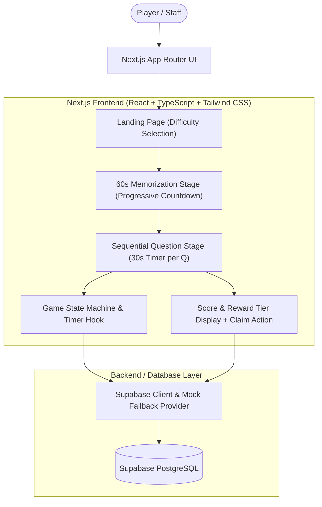

# Implementation Plan: Memory & Challenge Game

A full-stack interactive web application built with **Next.js (App Router, React, Tailwind CSS)** and **Supabase (PostgreSQL)** featuring timed image memorization, sequential question/challenge solving with strict 30-second deadlines, automated scoring, reward tiers, and database claim confirmation.

---

## 1. Architecture & Tech Stack

### Stack Details
- **Frontend Framework**: Next.js 14+ (App Router), React 18/19, TypeScript
- **Styling & UI**: Tailwind CSS, Lucide React (icons), glassmorphism styling, accessible HTML dialogs & controls
- **Backend & Database**: Supabase (PostgreSQL) with `@supabase/supabase-js`
- **Resilience / Local Dev Mode**: Hybrid data layer that connects directly to live Supabase credentials if configured in `.env.local`, with an automatic high-fidelity in-memory/localStorage seed engine so the app runs out-of-the-box locally for instant preview and automated testing.
- **Testing Framework**: Vitest + React Testing Library for fast, reliable unit testing of timers, question selection algorithms, and score/reward calculations.

---

## 2. Database Schema (PostgreSQL / Supabase)

The schema supports 5 dedicated tables with foreign key constraints, indexes, and reward claim tracking:

### 1. `images`
Stores memorization images categorized by difficulty.
- `id`: `UUID PRIMARY KEY DEFAULT gen_random_uuid()`
- `title`: `TEXT NOT NULL`
- `image_url`: `TEXT NOT NULL`
- `difficulty`: `TEXT NOT NULL CHECK (difficulty IN ('Easy', 'Medium', 'Hard'))`
- `description`: `TEXT`
- `created_at`: `TIMESTAMPTZ DEFAULT now()`

### 2. `questions`
Stores questions associated with specific images, categorized as `'Question'` or `'Challenge'`.
- `id`: `UUID PRIMARY KEY DEFAULT gen_random_uuid()`
- `image_id`: `UUID NOT NULL REFERENCES images(id) ON DELETE CASCADE`
- `question_text`: `TEXT NOT NULL`
- `question_type`: `TEXT NOT NULL CHECK (question_type IN ('Question', 'Challenge'))`
- `options`: `JSONB` (Array of 4 string options for `'Question'` type, e.g. `["Red", "Blue", "Green", "Yellow"]`; `NULL` for `'Challenge'`)
- `correct_answer`: `TEXT NOT NULL` (e.g., exact matching choice text or `'PASS'` for challenge)
- `challenge_criteria`: `TEXT` (Staff instructions/criteria for challenge verification)
- `created_at`: `TIMESTAMPTZ DEFAULT now()`

### 3. `game_sessions`
Tracks active and finished player games.
- `id`: `UUID PRIMARY KEY DEFAULT gen_random_uuid()`
- `player_name`: `TEXT DEFAULT 'Anonymous Player'`
- `difficulty`: `TEXT NOT NULL CHECK (difficulty IN ('Easy', 'Medium', 'Hard'))`
- `image_id`: `UUID NOT NULL REFERENCES images(id)`
- `total_score`: `INT DEFAULT 0 CHECK (total_score >= 0 AND total_score <= 5)`
- `status`: `TEXT DEFAULT 'in_progress' CHECK (status IN ('in_progress', 'completed', 'abandoned'))`
- `started_at`: `TIMESTAMPTZ DEFAULT now()`
- `completed_at`: `TIMESTAMPTZ`

### 4. `session_answers`
Tracks individual answers per question within a session.
- `id`: `UUID PRIMARY KEY DEFAULT gen_random_uuid()`
- `session_id`: `UUID NOT NULL REFERENCES game_sessions(id) ON DELETE CASCADE`
- `question_id`: `UUID NOT NULL REFERENCES questions(id)`
- `user_answer`: `TEXT` (Player choice or Staff `'PASS'`/`'FAIL'`; `NULL` if timed out)
- `is_correct`: `BOOLEAN NOT NULL DEFAULT false`
- `is_timeout`: `BOOLEAN NOT NULL DEFAULT false`
- `time_spent_seconds`: `NUMERIC(4,1) DEFAULT 0`
- `created_at`: `TIMESTAMPTZ DEFAULT now()`

### 5. `reward_claims`
Tracks claimed prizes, tier reached, and timestamp.
- `id`: `UUID PRIMARY KEY DEFAULT gen_random_uuid()`
- `session_id`: `UUID NOT NULL UNIQUE REFERENCES game_sessions(id) ON DELETE CASCADE`
- `reward_tier`: `TEXT NOT NULL` (`'Bronze'`, `'Silver'`, `'Gold'`, `'Diamond'`, `'Participant'`)
- `claim_status`: `TEXT DEFAULT 'pending' CHECK (claim_status IN ('pending', 'claimed'))`
- `claim_code`: `TEXT NOT NULL UNIQUE`
- `claimed_at`: `TIMESTAMPTZ`
- `created_at`: `TIMESTAMPTZ DEFAULT now()`

---

## 3. Core Logic & Algorithms

### A. Question Selection Algorithm (Max 2 Challenges)
1. Query all questions matching the selected image (`image_id`).
2. Separate questions into `questionPool` and `challengePool`.
3. Pick between 0 and 2 questions randomly from `challengePool` (e.g. `numChallenges = min(challengePool.length, 2)`).
4. Fill the remaining spots up to 5 from `questionPool` (e.g. `5 - numChallenges` questions). If `questionPool` has fewer questions, draw from whichever pool is available to guarantee exactly 5 questions.
5. Shuffle the resulting 5 questions so challenges appear unpredictably throughout the sequence.

### B. Image Timer (Strict 60 Seconds)
- Starts immediately when image loads.
- Visual circular progress & countdown bar (60 -> 0s).
- Image is strictly unmounted from the DOM at $t = 0$ seconds so it cannot be inspected or seen again during the question phase.
- Includes an optional "I'm Ready Early" button for impatient players.

### C. Sequential Question Timer (Strict 30 Seconds)
- Resets to 30.0s at each question index (0 to 4).
- High precision tick using `requestAnimationFrame` or 100ms interval to prevent drift.
- When $t \le 0$:
  - Automatically submits with `is_timeout: true`, `user_answer: null`, `is_correct: false`.
  - Shows quick 1.5s visual feedback ("Time's Up!").
  - Auto-advances to question $i + 1$.

### D. Question Type Rendering
- **'Question' Type**:
  - Displays question text.
  - 4 styled interactive option cards (A, B, C, D).
  - Instant selection & lock-in.
- **'Challenge' Type**:
  - Displays interactive Challenge badge.
  - Clear prompt instructions for the player & staff evaluator.
  - Staff "Pass" and "Fail" action buttons with authorization confirmation modal/toggle.

### E. Scoring & Reward Tiers
Score scale: 0 to 5 points (1 point per correct question or passed challenge).
- **5 / 5 points**: **Diamond Grand Champion** (Exclusive Reward Voucher)
- **4 / 5 points**: **Gold Tier** (Premium Mystery Pack)
- **3 / 5 points**: **Silver Tier** (Standard Gift Voucher)
- **1 - 2 points**: **Bronze Tier** (Souvenir Sticker / Badge)
- **0 points**: **Participant Certificate**

### F. Claim Reward Action
- Clicking "Confirm Claim" sends an update to Supabase (`reward_claims` table).
- Updates `claim_status: 'claimed'`, sets `claimed_at: now()`.
- Renders unique Claim Voucher Badge with QR/Verification Code and timestamp.

---

## 4. Testing Strategy

1. **Question Selection Unit Tests**:
   - Verify selection always outputs exactly 5 questions.
   - Verify count of `'Challenge'` questions never exceeds 2 under various pool distributions.
   - Verify handling when pool has 0 challenges or only challenges.
2. **Timer Logic Unit Tests**:
   - Verify image timer decrements to 0 and invokes hide callback.
   - Verify 30-second question timer counts down accurately.
   - Verify timeout trigger dispatches auto-fail score 0 and advances to the next question.
3. **Score & Reward Calculation Tests**:
   - Verify score matches sum of `is_correct` answers (0 to 5).
   - Verify correct Reward Tier mapping for all score values [0, 1, 2, 3, 4, 5].
4. **Claim Confirmation State Tests**:
   - Verify claim button transitions status from `'pending'` to `'claimed'`.
   - Verify repeated clicks are prevented (idempotence).

---

## 5. Implementation Roadmap

1. **Phase 1: Project Scaffolding & Setup**
   - Initialize Next.js app with Tailwind CSS, Lucide icons, TypeScript.
   - Set up Vitest and React Testing Library.
2. **Phase 2: Database Schema & Mock Data Fixtures**
   - Create `supabase/schema.sql` with all 5 tables, constraints, and indexes.
   - Create `supabase/seed.sql` and `src/data/dummyData.ts` with diverse images (Easy/Medium/Hard) and 6-10 questions per image.
   - Create Supabase client helper with automatic fallback to mock repository.
3. **Phase 3: Core Game Logic & Unit Tests**
   - Implement `questionSelector.ts`, `scoreCalculator.ts`, and timer hooks.
   - Write comprehensive unit tests in `src/__tests__/`.
   - Run tests to ensure 100% green verification.
4. **Phase 4: UI Components & Game Flow**
   - `LandingPage`: Difficulty selection cards with preview stats.
   - `MemoryStage`: 60-second high-contrast image countdown with secure unmounting.
   - `QuestionStage`: 30-second timer, option selector for 'Question', staff Pass/Fail buttons for 'Challenge'.
   - `ResultStage`: Score breakdown, reward tier card, and interactive "Confirm Claim" database mutation.
5. **Phase 5: Local Preview & End-to-End Verification**
   - Launch Next.js dev server on local port.
   - Test full playthrough on Easy, Medium, and Hard.
   - Verify timeout auto-advancement and reward claim workflow.
